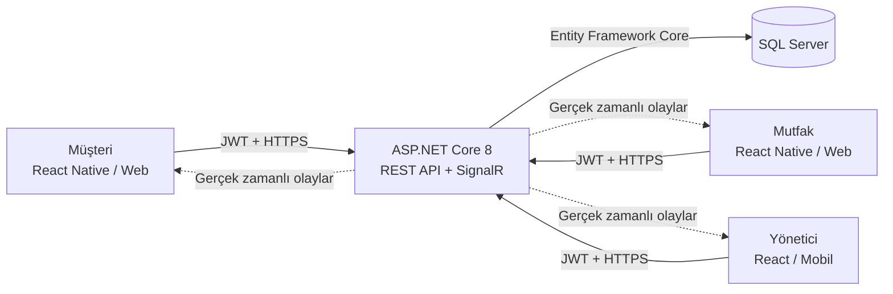

# Restoran Otomasyonu

QR kodla masadan sipariş, gerçek zamanlı mutfak takibi ve yönetim raporlarını tek
bir sistemde birleştiren restoran otomasyonu.


## Proje hakkında

Restoran Otomasyonu; müşteri, mutfak personeli ve yönetici rollerini aynı backend
üzerinden güvenli biçimde çalıştırır. Müşteri masadaki QR kodu okutarak menüye
ulaşır ve sipariş verir. Sipariş SignalR üzerinden anlık olarak mutfak ekranına
düşer. Mutfak sipariş durumlarını yönetirken yönetici menü, masa, sipariş ve
satış raporlarına erişebilir.

Uygulama web üzerinde tek porttan çalışabilir. Expo tabanlı mobil istemci Android
uygulaması olarak da derlenebilir.

## Özellikler

### Müşteri

- QR kodla restoran ve masa tanıma
- Kategori bazlı, görselli dijital menü
- Ürün seçenekleri ve sipariş notları
- Sepet ve masadan sipariş oluşturma
- Sipariş durumunu gerçek zamanlı takip etme
- Hesap isteme ve ödeme yöntemi seçme
- Geçmiş siparişleri görüntüleme
- Ürünleri favorilere ekleme
- Tamamlanan siparişlere puan ve yorum bırakma
- Profil, e-posta, telefon ve şifre bilgilerini yönetme
- Sipariş durumu için mobil bildirim desteği

### Mutfak

- Yeni siparişleri anlık görüntüleme
- Yeni siparişte sesli ve görsel uyarı
- En eski siparişi önce gösterme
- Uzun süredir bekleyen siparişleri belirginleştirme
- Sipariş kalemlerini hazırlanıyor/hazır olarak işaretleme
- Siparişi gerekçe belirterek iptal etme
- Hesap talebini ve müşterinin ödeme tercihini görüntüleme
- Ödeme tamamlandığında masayı otomatik boşaltma

### Yönetici

- Kategori ve menü ürünü CRUD işlemleri
- Ürün fiyatı, görseli, satış durumu ve sıralamasını yönetme
- Masa oluşturma, düzenleme ve QR kod üretme
- Aktif ve geçmiş siparişleri inceleme
- Günlük rapor ve tarih aralığına göre satış analizi
- Ciro, en çok satan ürünler ve son siparişleri görüntüleme
- Raporları PDF olarak indirme
- Web ve mobil yönetim ekranı

## Mimari



## Kullanılan teknolojiler

| Katman | Teknolojiler |
| --- | --- |
| Backend | ASP.NET Core 8, C#, REST API, SignalR |
| Kimlik doğrulama | ASP.NET Core Identity, JWT Bearer |
| Veritabanı | SQL Server, Entity Framework Core |
| Yönetim paneli | React, TypeScript, Vite |
| Mobil ve müşteri arayüzü | React Native, Expo, TypeScript |
| PDF raporları | QuestPDF |
| API dokümantasyonu | Swagger / OpenAPI |

## Güvenlik

- `Customer`, `Kitchen` ve `Admin` rolleri birbirinden ayrılmıştır.
- API uçları rol bazlı yetkilendirme kullanır.
- Müşteriler yalnızca kendilerine ait siparişlere erişebilir.
- SignalR bağlantıları kimlik doğrulaması ve kullanıcı/rol gruplarıyla sınırlandırılır.
- Eş zamanlı isteklerde aynı masaya iki sipariş açılması veritabanı seviyesinde engellenir.
- Giriş ve müşteri işlemlerine IP/kullanıcı bazlı hız sınırı uygulanır.
- İstek modellerinde uzunluk, aralık ve biçim doğrulamaları bulunur.
- HSTS, Content Security Policy ve diğer temel güvenlik başlıkları kullanılır.
- JWT anahtarı ve başlangıç parolaları kaynak koddan ayrı tutulur.

> Gerçek anahtarları, parolaları veya sertifikaları repoya eklemeyin.
> `appsettings.Development.json` ve `.env` dosyaları Git tarafından izlenmez.

## Proje yapısı

```text
RestaurantApp/
├── RestaurantApp/       # ASP.NET Core API, veritabanı ve yayınlanan web dosyaları
├── admin-web/           # React yönetim paneli
├── customer-mobile/     # Expo müşteri, mutfak ve mobil yönetim uygulaması
├── kitchen-kds/         # Ayrı mutfak ekranı istemcisi
├── STARTUP.md           # Ayrıntılı yerel çalıştırma notları
└── start-all.cmd        # Web uygulamalarını tek portta başlatır
```

## Yerel kurulum

### Gereksinimler

- [.NET 8 SDK](https://dotnet.microsoft.com/download/dotnet/8.0)
- SQL Server LocalDB veya erişilebilir bir SQL Server
- Node.js
- pnpm

### 1. Yapılandırmayı oluşturun

`RestaurantApp/appsettings.Development.example.json` dosyasını
`RestaurantApp/appsettings.Development.json` adıyla kopyalayın. Örnek JWT
anahtarını en az 32 karakterden oluşan rastgele bir değerle, başlangıç hesaplarını
ise kendi güvenli bilgilerinizle değiştirin.

```powershell
Copy-Item `
  .\RestaurantApp\appsettings.Development.example.json `
  .\RestaurantApp\appsettings.Development.json
```

### 2. Veritabanını hazırlayın

```powershell
cd .\RestaurantApp
dotnet ef database update
cd ..
```

### 3. Uygulamayı başlatın

```powershell
.\start-all.cmd
```

Varsayılan yerel adresler:

| Ekran | Adres |
| --- | --- |
| Giriş | `http://localhost:5223/` |
| Müşteri | `http://localhost:5223/customer` |
| Mutfak | `http://localhost:5223/kitchen` |
| Yönetim | `http://localhost:5223/admin/` |
| Swagger | `http://localhost:5223/swagger` |

Yeni kayıt olan kullanıcılar otomatik olarak `Customer` rolünü alır. `Kitchen`
ve `Admin` hesapları yalnızca güvenli başlangıç yapılandırmasıyla oluşturulur.

## Geliştirme komutları

Backend:

```powershell
dotnet build .\RestaurantApp\RestaurantApp.csproj
dotnet run --project .\RestaurantApp\RestaurantApp.csproj --launch-profile http
```

Yönetim paneli:

```powershell
cd .\admin-web
pnpm install
pnpm run dev
```

Müşteri/mobil uygulaması:

```powershell
cd .\customer-mobile
.\pnpm-local.cmd install
.\start-expo.cmd
```

Android APK:

```powershell
cd .\customer-mobile
.\build-android-apk.cmd
```

Daha ayrıntılı başlangıç ve web derleme adımları için
[STARTUP.md](STARTUP.md) dosyasına bakın.

## Yol haritası

- Otomatik test ve GitHub Actions CI
- Stok ve malzeme takibi
- Masa rezervasyonu
- Çoklu restoran desteği
- Personel ve yetki yönetimi
- Denetim kaydı (audit log)
- Otomatik veritabanı yedekleme

## Proje durumu

Proje aktif olarak geliştirilen bir MVP'dir. Üretim ortamına geçmeden önce
ortama özel HTTPS, veritabanı yedekleme, merkezi günlük kaydı ve gizli anahtar
yönetimi yapılandırılmalıdır.
